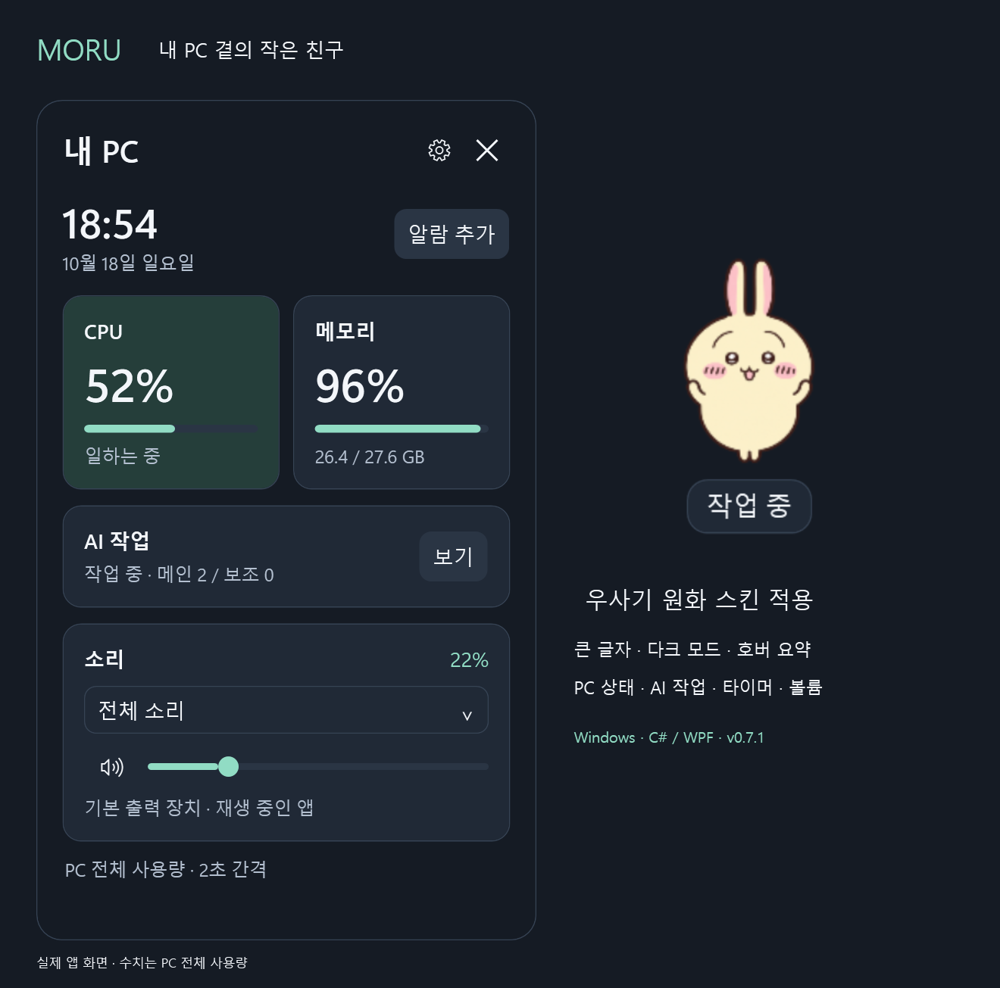
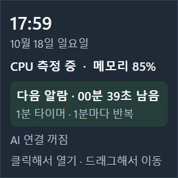
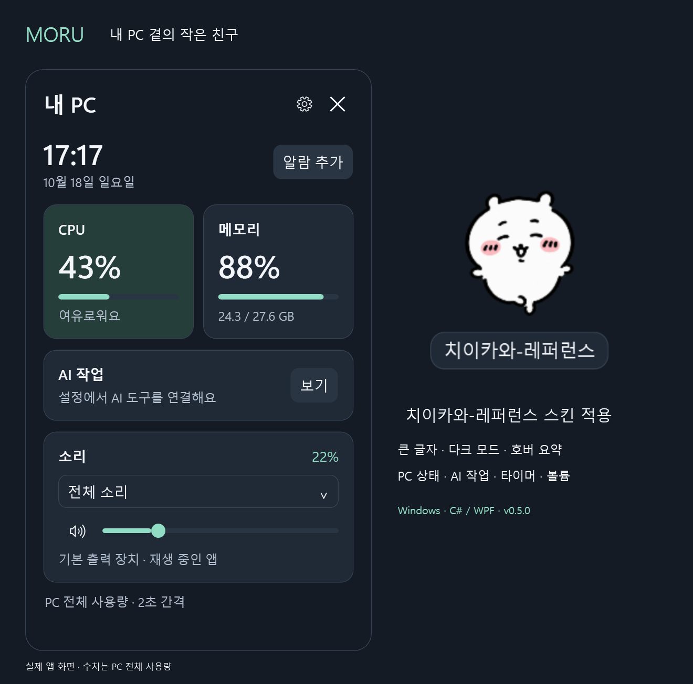
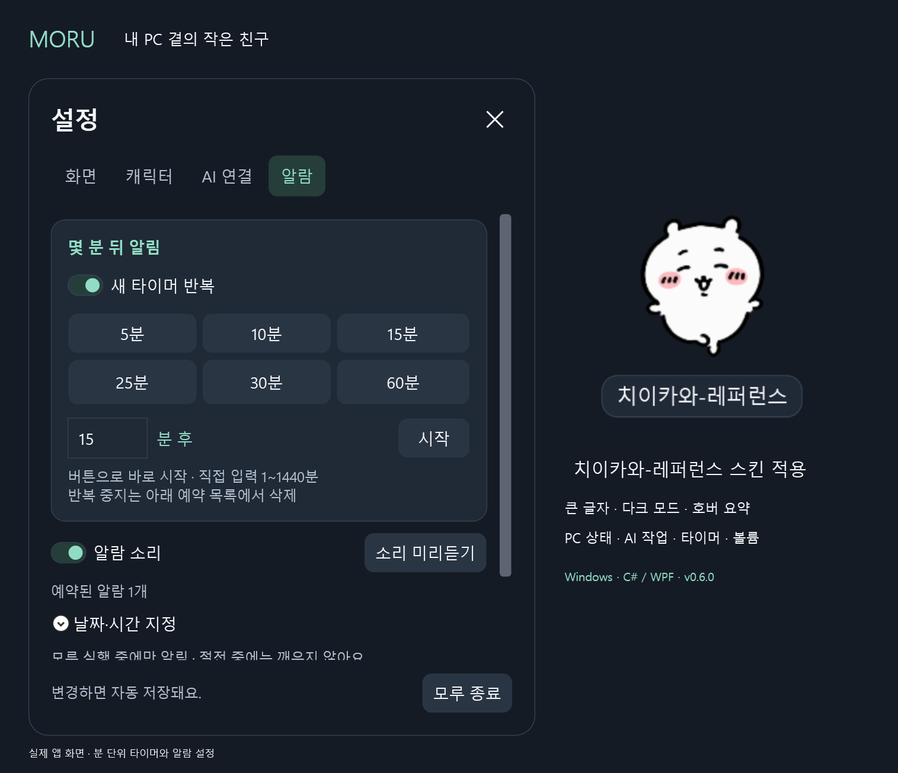
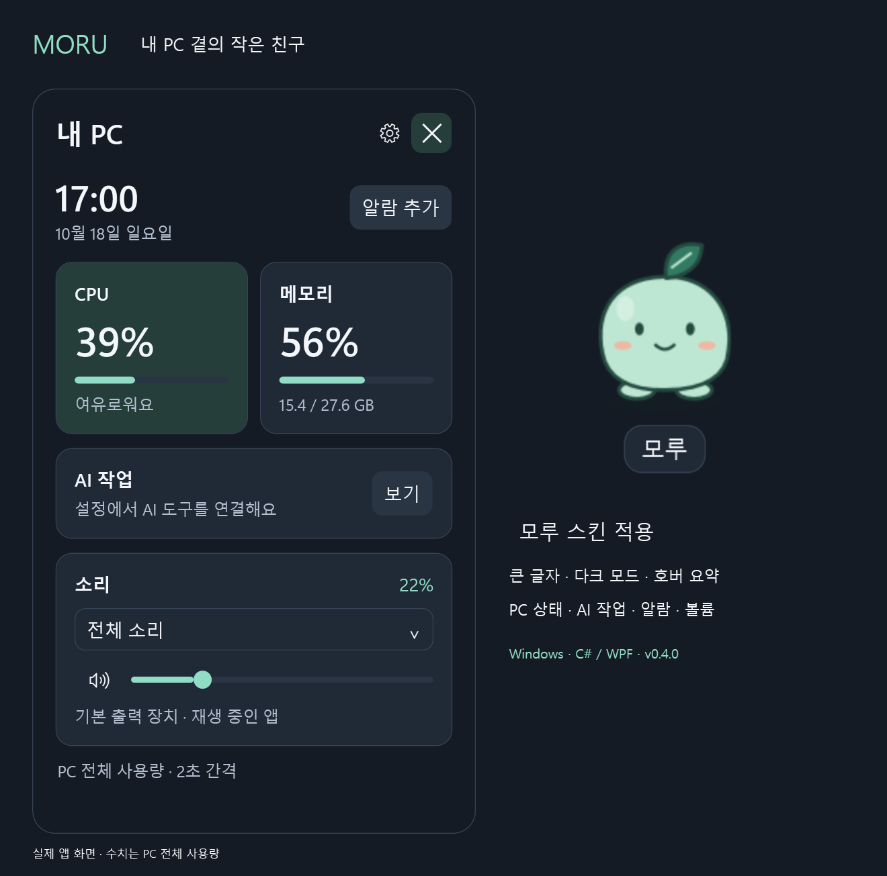
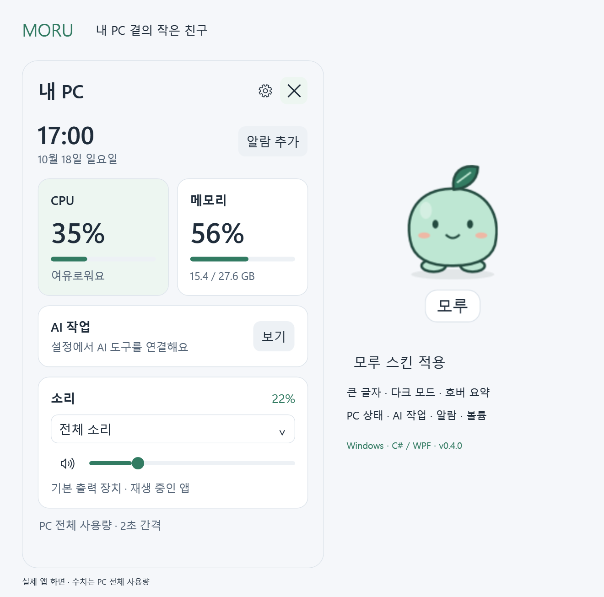
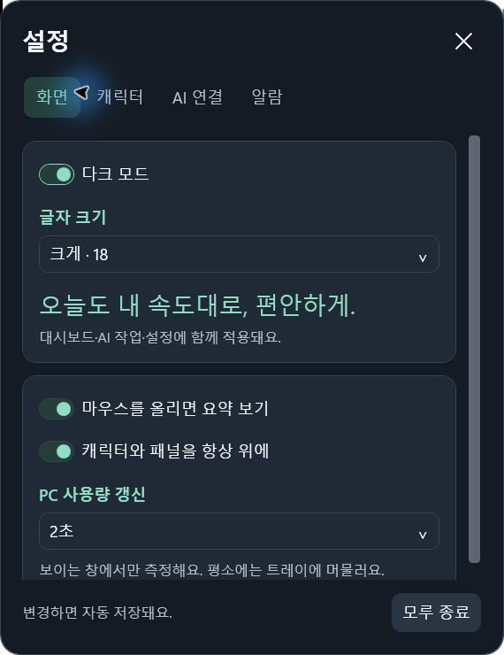
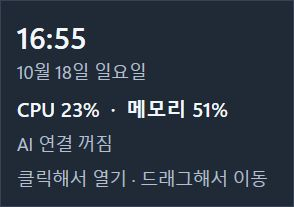
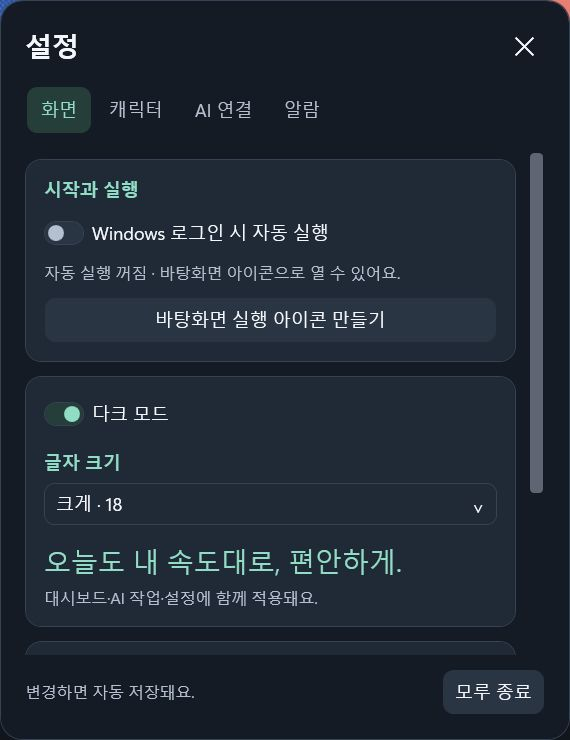

# 모루 — 내 PC 곁의 작은 친구

Windows용 C# / WPF 데스크톱 캐릭터, **v0.8.0 · MIT 오픈소스**.
캐릭터를 클릭하면 전체 CPU 사용률과 물리 메모리 사용량을 보여 줍니다.
새싹 **모루**, 고양이 **소금**, 로봇 **루미**를 선택하면 캐릭터와 패널 색상이 함께 바뀝니다.
투명 PNG 한 장으로 나만의 캐릭터를 추가하고, 현재 적용 화면을 사진으로 저장할 수 있습니다.
**쉬는 중·작업 중·완료·확인 대기·오류**마다 다른 PNG를 지정할 수 있습니다. 없는 상태는 기본 이미지를 사용합니다.
캐릭터가 대기·작업·완료 상태에 맞춰 움직입니다. **Codex / Claude Code**를 연결하면 작업 상태와 도구가 제공하는 사용량도 볼 수 있습니다.




2026-10-18 우사기 예시를 새 스킨으로 교체했습니다. 기본 모습은 [공식 애니메이션 사이트](https://www.anime-chiikawa.jp/chara.html)의 투명 원본 이미지이며, 작업·완료·확인 대기·오류 모습은 이 원본을 기준으로 AI 편집했습니다. 기존 움직임은 유지했습니다. 스킨은 개인 적용 예시로 기본 제공하지 않으며, 캐릭터 부분에는 모루의 MIT 라이선스가 적용되지 않습니다. [이미지 권리 안내](THIRD-PARTY-NOTICES.md)

**캐릭터에 마우스를 올리면 다음 알람까지 남은 시간**을 보여 줍니다. 10분·15분 타이머에 **반복**을 켜면 같은 간격으로 계속 알려 줍니다.







치이카와는 사용자 PNG 스킨의 적용 예시입니다. 스킨 파일은 기본 제공하지 않으며, 예시 속 캐릭터의 권리는 원권리자에게 있습니다. [이미지 권리 안내](THIRD-PARTY-NOTICES.md)










사진은 앱의 실제 패널·캐릭터를 내보낸 것입니다. 표시되는 CPU·메모리는 촬영 당시 PC 전체 수치입니다.

## 설치하고 실행하기

1. [v0.8.0 설치 파일](https://github.com/heopath/moru-desktop/releases/download/v0.8.0/Moru-Setup-0.8.0-win-x64.exe)을 받아 실행합니다.
2. 설치가 끝나면 바탕화면의 **모루 실행** 아이콘으로 엽니다. .NET은 포함되어 있어 따로 설치할 필요가 없습니다.
3. **자동 실행은 기본 꺼짐**입니다. 필요할 때 ⚙ → **화면 → Windows 로그인 시 자동 실행**을 켭니다.

현재 사용자에게만 설치하며 관리자 권한을 요구하지 않습니다. 기본 설치 위치는 `%LocalAppData%\Programs\Moru`입니다. 시작 메뉴와 Windows **설치된 앱**에서도 찾거나 제거할 수 있습니다. 기존 스킨·설정은 업데이트와 제거 후에도 `%LocalAppData%\Moru`에 남습니다. 이미 자동 실행을 켜 둔 사용자의 선택은 업데이트 시 유지합니다.
현재 배포 파일에는 코드 서명이 없어 Windows에서 게시자 확인 경고가 표시될 수 있습니다.

### 압축 파일로 실행하기

- [Releases](https://github.com/heopath/moru-desktop/releases)에서 `Moru-win-x64.zip`을 받습니다. **전체 압축을 풀고** 그 안의 `Moru.exe`를 실행합니다.
- 소스 작업 폴더에서는 빌드 후 `Start-Moru.cmd`를 더블클릭합니다. 로컬 배포 ZIP은 `artifacts/Moru-win-x64.zip`입니다.
- 포터블 배포본은 .NET 런타임을 포함하므로 별도의 개발 도구 설치가 필요 없습니다. exe만 따로 옮기면 실행되지 않습니다.
- 첫 실행 때 바탕화면에 **모루 실행** 아이콘을 만듭니다. 다음부터 이 아이콘으로 열면 됩니다.
- **자동 실행은 기본 꺼짐**입니다. ⚙ → **화면 → Windows 로그인 시 자동 실행**에서 켜거나 끕니다.
- Windows 10/11 x64용입니다. 관리자 권한, 계정, 서버, 인터넷 연결이 필요하지 않습니다.

마우스를 올리면 짧은 요약, 클릭하면 대시보드, ⚙를 누르면 설정을 엽니다. 다크 모드와 글자 크기(16/18/20)는 설정의 **화면** 탭에서 바꿀 수 있습니다.



## 조작

| 동작 | 결과 |
| --- | --- |
| 캐릭터 클릭 / 키보드로 초점 후 Enter | 상태 패널 열기·닫기 |
| 캐릭터 드래그 | 위치 이동 및 저장 |
| 캐릭터 우클릭 | 상태 보기, 숨기기, 위치 초기화, 종료 |
| 캐릭터에 마우스 올리기 | 다음 알람까지 남은 시간·반복 간격, 시각·날짜·CPU·메모리·AI 상태 |
| 대시보드 ⚙ → 화면 | 자동 실행, 바탕화면 아이콘 만들기, 다크 모드, 글자 16/18/20, 호버, 항상 위, 갱신 간격 |
| ⚙ → 캐릭터 | 스킨 선택·이름 변경·삭제·기본 복원, PNG 추가, 상태별 모습, 애니메이션 |
| ⚙ → AI 연결 | Codex / Claude Code 연결·해제 |
| 대시보드 AI 작업 → 보기 | 메인·보조 작업과 사용량 |
| 대시보드 알람 | 5/10/15/25/30/60분 버튼, 원하는 분 수, 지정 날짜·시각 알림 |
| 대시보드 소리 | 전체 또는 재생 중인 앱의 볼륨·음소거 |
| 패널 × 또는 Esc | 패널 닫기, 측정 정지 |
| 트레이의 모루 아이콘 클릭 | 숨겨진 캐릭터와 패널 다시 열기 |
| 설정 또는 우클릭 메뉴의 종료 | 프로세스 완전히 종료 |
| 열린 대시보드의 작업 표시줄 닫기 | 대시보드만 닫고 캐릭터는 유지 |

평소에는 캐릭터와 트레이 아이콘만 표시합니다. 대시보드·설정·AI 작업 중 열린 창 하나만 작업 표시줄에 나타납니다. Windows의 숨겨진 트레이 아이콘 영역에도 모루가 있을 수 있습니다.
자동 시작은 사용자가 켰을 때만 현재 Windows 사용자에게 등록합니다. 로그인 시 대시보드 없이 캐릭터만 나타납니다. 위치·스킨·테마·글자 크기·예약 알람 등은 `%LocalAppData%/Moru/settings.json`에, 추가한 PNG는 같은 폴더의 `UserSkins`에 저장됩니다.
압축을 푼 모루 폴더는 계속 같은 곳에 보관하세요. 옮겼다면 새 위치에서 실행한 뒤 자동 실행을 껐다 켜고 **바탕화면 실행 아이콘 만들기**를 눌러 경로를 갱신합니다. 아이콘을 직접 삭제해도 매번 다시 만들지는 않습니다. Windows 시작 앱에서 별도로 사용 안 함으로 설정했다면 그 설정도 확인하세요.
사용 기록이나 측정 이력은 저장하지 않습니다.

## 캐릭터 이름 변경과 삭제

⚙ → **캐릭터**에서 원하는 친구를 선택한 뒤 **선택한 캐릭터 관리**를 사용합니다.

- **이름 변경:** 1~12자를 입력하고 **이름 변경** 또는 Enter를 누릅니다. 상태별 이미지와 이름은 재실행해도 유지됩니다.
- **캐릭터 삭제:** 내가 추가한 친구와 모루에 저장된 상태 이미지 복사본을 삭제합니다. 처음 선택했던 원본 PNG는 그대로 남습니다.
- **목록에서 제거:** 기본 캐릭터를 숨깁니다. **기본 캐릭터 복원**을 누르면 다시 나타납니다.
- 마지막 캐릭터 한 명은 남깁니다. 다른 친구를 추가하거나 기본 캐릭터를 복원한 뒤 삭제할 수 있습니다.

## 알람과 소리

1. 캐릭터 클릭 → **알람** 또는 **⚙ → 알람**을 엽니다.
2. **10분·15분** 등 빠른 버튼을 누르면 즉시 시작합니다. 원하는 시간은 **1~1440분** 사이 정수를 입력하고 **시작**을 누릅니다.
3. **알람 소리**를 켜고 **소리 미리듣기**로 출력 상태를 확인합니다. 예약 목록에서 알림 시각을 확인하거나 취소할 수 있습니다.

- **반복:** 먼저 **새 타이머 반복**을 켜고 **10분** 또는 **15분** 등을 누릅니다. 직접 입력한 분 수에도 적용됩니다. 이후 같은 간격으로 계속 울리며, 확인 버튼을 눌러도 반복 예약은 유지됩니다.
- **중지:** 아래 예약 목록에서 해당 알람의 휴지통 버튼을 누릅니다. 위의 반복 스위치는 앞으로 새로 시작할 타이머에만 적용하며 기존 예약은 바꾸지 않습니다.
- **남은 시간:** 캐릭터에 마우스를 올리면 가장 가까운 알람의 남은 시간과 반복 간격을 표시합니다. 여러 개면 추가 예약 개수도 표시합니다. 알람이 없으면 이 영역은 숨깁니다.
- 반복 간격·다음 알림 시각·새 타이머 반복 옵션을 저장하므로 재실행해도 유지됩니다. 절전·종료 중 놓친 알람은 복귀 후 한 번만 알리고 원래 주기의 다음 시각으로 넘어갑니다.
- 반복 알람의 **5분 뒤 다시**는 같은 예약을 5분 뒤로 미루고 그 시각부터 다시 반복합니다. 별도 반복 예약을 추가하지 않습니다.
- 정해진 시간이 되면 알림 창과 약 2초의 전용 알림음이 한 번 재생됩니다. 확인·다시 알림·창 닫기·소리 끄기는 재생을 중단합니다.
- 알림음은 Windows 출력 장치와 모루 앱 볼륨을 따릅니다. 음소거를 강제로 해제하거나 볼륨을 올리지 않습니다. 미리듣기는 소리 설정이 꺼져 있어도 누르면 재생됩니다.
- **날짜·시간 지정**을 펼치면 특정 날짜와 시각에 제목을 붙인 알람도 만들 수 있습니다.
- 알람은 최대 8개를 예약합니다. 시간이 되면 작은 창이 뜨며 확인 또는 5분 뒤 다시 알림을 선택할 수 있습니다.
- 모루 실행 중에만 알림이 뜹니다. PC를 깨우지 않으며, 잠금·절전 복귀나 다음 실행 시 놓친 예약을 표시합니다.
- 전체 소리는 기본 출력 장치의 볼륨입니다. 앱별 소리는 해당 장치에서 현재 재생 중인 프로세스의 볼륨입니다. 브라우저 탭별 조절, 재생·일시정지, 곡 정보는 지원하지 않습니다.
- 재생이 끝난 앱은 목록에서 빠집니다. 출력 장치가 바뀌면 새 기본 장치를 기준으로 갱신하며, 조절할 대상이 없으면 안내합니다.

## 가볍게 동작하는 방법

- WebView, 웹 서버, 외부 패키지, WMI 조회, 프로세스 전체 순회 없이 Windows 기본 API로 두 가지 지표만 읽습니다.
- CPU는 `GetSystemTimes`의 두 시점 차이, RAM은 `GlobalMemoryStatusEx`로 측정합니다.
- **대시보드·호버 요약이 보일 때만 CPU·RAM을 측정합니다.** 다시 열면 CPU 기준점을 새로 잡으므로 첫 값까지 한 주기가 필요합니다.
- 볼륨은 대시보드가 열려 있을 때만 4초 이상 간격으로 읽습니다. 연속 조절 입력을 모아 반영하며 다른 앱의 오디오는 녹음하지 않습니다.
- 예약 알람이 없으면 알람 타이머도 멈춥니다. 예약이 있으면 다음 시각을 기준으로 기다립니다.
- 남은 시간의 초 단위 갱신은 호버가 보일 때만 동작합니다. CPU·메모리는 기존 2/5/10초 설정대로 측정하며, 숨기면 호버 타이머도 멈춥니다.
- 알림음은 처음 필요할 때 약 86 KiB의 WAV를 메모리에서 만들어 재사용합니다. 알람을 위해 상시 재생하거나 새 반복 감시를 추가하지 않습니다.
- 화면 잠금·절전 동안에도 측정을 정지하고, 복귀 시 기준점을 초기화합니다.
- 캐릭터는 작은 벡터 또는 PNG입니다. 12fps의 짧은 WPF 변환 애니메이션을 재생한 뒤 쉽니다. 작업 중에는 4초 간격, 대기 중에는 8초 간격이며 상시 프레임 루프는 없습니다.
- 숨김·화면 잠금·절전·드래그 중에는 애니메이션을 멈춥니다. Windows의 애니메이션 끄기 설정도 존중합니다.
- Codex 연결은 파일 변경 이벤트를 모아 새 기록만 제한적으로 읽습니다. 별도 Codex 서버나 모델 요청을 실행하지 않습니다.
- Claude Code 연결은 작업 이벤트 때만 짧은 프로세스를 실행해 같은 사용자 전용 로컬 파이프로 메타데이터를 보냅니다. 모루가 꺼져 있어도 빠르게 종료됩니다.
- 사용자 PNG는 긴 변 최대 320px로 한 번 디코딩하고, 저장한 이미지를 캐릭터와 선택 목록에서 함께 재사용합니다.
- 상태별 PNG도 한 번만 읽고 상태가 바뀔 때 이미 준비된 이미지로 교체합니다. 이미지 변경이나 자동 실행을 위해 상시 감시 타이머를 추가하지 않습니다.
- 브러시와 고정 도형은 동결하여 재사용합니다. 움직임이 끝나면 화면 갱신도 쉽니다.
- 디스크의 포터블 배포 크기는 .NET 런타임을 포함합니다. 실행 중 실제 메모리와는 다른 수치입니다.
- WPF 자체의 메모리 비용은 있습니다. CPU 0%나 특정 메모리 상한을 모든 PC에서 보장하지 않습니다.

실측 절차와 결과는 [검증 기록](docs/verification.md)에 있습니다.
v0.8.0은 이름 변경·삭제·복원과 Windows 설치 파일을 추가했고 핵심 검사 **138개**를 통과했습니다. 캐릭터 관리에는 새로운 상시 타이머나 이미지 재디코딩을 추가하지 않았습니다.
v0.7.1은 영문 Windows의 한글 바로가기 저장 문제를 수정했고 핵심 검사 **120개**를 통과했습니다.
v0.7.0은 핵심 검사 **119개**를 통과했습니다. 우사기 5개 상태 이미지를 읽은 뒤 AI 연결을 끈 30초 측정에서 캐릭터만 표시하면 평균 CPU **0.0425% / 메모리 172.83 MiB**, 대시보드 2초 갱신 시 **0.1970% / 205.81 MiB**였습니다. 24개 논리 프로세서 전체 기준 CPU와 평균 작업 집합이며 다른 PC에서의 보장값은 아닙니다.
v0.6.0은 반복 예약·다시 알림·남은 시간·기존 설정 호환을 포함한 핵심 검사 **102개**를 통과했습니다. 아래 자원 측정값은 해당 이전 버전의 기록입니다.
최종 v0.4.0은 **개인 PNG 애니메이션 + Codex 관찰**을 켠 별도 실행을 각 30초 측정했습니다. 캐릭터만 표시할 때 평균 CPU **0.2429%**, 작업 집합 **188.11 MiB**, 대시보드 2초 갱신 시 CPU **1.2031%**, 작업 집합 **199.86 MiB**였습니다. 논리 CPU 24개인 이 PC의 짧은 관측이며 버전 간 통제된 비교는 아닙니다. 핵심 검사 77개를 통과했습니다.
최종 v0.3.0은 **PNG 캐릭터 애니메이션 + 실제 Codex 관찰, 패널을 닫은 상태**에서 30.75초 동안 평균 CPU **0.2012%**, 작업 집합 **190.06 MiB**(표본 최대 195.33 MiB)를 기록했습니다. 논리 CPU 24개인 한 PC의 짧은 관측값입니다.
최종 v0.2.0의 PNG 캐릭터·2초 갱신 패널 상태를 약 33초 측정한 결과는 평균 CPU **0.164%**, 작업 집합 **198 MiB**였습니다.
이는 소개 화면을 내보낸 뒤의 이 PC 측정값이며, 모든 환경에서의 보장치가 아닙니다.
2026-10-18 실제 Windows 환경에서 캐릭터 표시, 클릭으로 패널 열기·닫기, 스킨 3종 변경, 재실행 후 스킨 복원을 확인했습니다.
v0.3.0은 상태 전이·부분 파일 읽기·훅 설정 보존을 포함한 핵심 검사 61개를 통과했습니다.
v0.1.0에서 각각 약 30초씩 두 번 측정했을 때, 캐릭터만 표시하는 실행의 평균 CPU는 0.077~0.119% / 메모리는 165~168 MiB,
패널을 2초 간격으로 갱신하는 실행은 CPU 0.137~0.357% / 메모리 183~184 MiB였습니다.
패널을 닫은 뒤 측정에서는 CPU 0.009% / 메모리 179 MiB였으며, 숨긴다고 메모리가 즉시 반환되지는 않습니다.
CPU는 전체 논리 프로세서 기준이며 메모리는 공유 페이지를 포함한 작업 집합입니다. 짧은 한 환경의 측정값이므로 모든 PC의 상한을 뜻하지 않습니다.

## AI 도구 연결

캐릭터 클릭 → **⚙ → AI 연결** → 연결할 도구를 켭니다. 처음 설치할 때는 두 연결 모두 꺼져 있습니다.
현재 Claude Code 연결에는 **Git for Windows의 Git Bash**가 필요합니다. 설치되어 있지 않으면 설정을 변경하지 않고 안내합니다. 사용자 지정 경로는 `CLAUDE_CODE_GIT_BASH_PATH`로 지정할 수 있습니다.

| 도구 | 연결 방식 | 표시 범위 |
| --- | --- | --- |
| Codex Desktop / CLI | 로컬 `CODEX_HOME/sessions` JSONL 읽기, 기본 `~/.codex/sessions` | 메인·보조 활동, 완료, 최근 대화 누적 토큰, 기록에 포함된 한도 |
| Claude Code | 공식 작업 훅 + status line | 작업·승인 대기·완료·보조 작업, 컨텍스트 비율, 제공되는 5시간/7일 한도 |

Claude 연결 버튼은 `CLAUDE_CONFIG_DIR/settings.json`(기본 `~/.claude/settings.json`)을 백업하고 모루 훅을 추가합니다. **새 Claude Code 세션부터 적용**됩니다. 기존 status line이 있으면 보존하므로 사용량 연결은 생략됩니다. 연결을 끄면 모루 항목만 제거합니다. 실행 파일 위치를 옮겼다면 연결을 껐다 켜서 경로를 갱신하세요.

Codex는 **로컬 기록 형식에 의존하는 실험적 관찰 기능**입니다. 공식 App Server의 다른 프로세스에서 현재 데스크톱 작업 전체를 구독한다고 가정하지 않습니다. 최신 파일 12개로 시작하고 이후 변경된 파일을 최대 32개 추적합니다. 누락되거나 5분간 조용한 작업은 상태 확인 필요로 표시합니다. 전체 과거 작업 목록을 보장하지 않습니다.

한도는 마지막 이벤트 수신값이며 자동으로 서버를 조회하지 않습니다. 토큰 누적에는 캐시 입력이 포함되며 최신 대화가 바뀌면 수치도 바뀝니다. 컨텍스트 점유율·사용 한도·요금을 구분하며 미수신 값을 0으로 표시하지 않습니다. 메인 응답이 끝나도 실행 중인 보조 작업은 유지합니다.

모루는 AI 요청을 대신 보내거나 승인을 대신하지 않습니다. API 키, 인증 파일, 대화 본문을 보관하거나 전송하지 않습니다. Codex 파일을 읽는 과정에서 본문 바이트도 메모리를 지나지만 상태·수치만 추출하고 버립니다. Claude 훅도 원문 입력에서 같은 메타데이터만 추려 파이프로 보냅니다. 일반 Claude 웹/채팅 앱은 현재 지원하지 않습니다.

공식 참고: [Codex App Server](https://learn.chatgpt.com/docs/app-server), [Claude Code hooks](https://code.claude.com/docs/en/hooks), [Claude Code status line](https://code.claude.com/docs/en/statusline).

## 다음 개발 방향

[캐릭터 제작 가이드](docs/custom-character-guide.md)에는 PNG 규격과 AI용 프롬프트가 있습니다.
[추가 요구사항](docs/roadmap.md)에는 여러 프레임을 사용하는 스프라이트 지원, 더 안정적인 AI 연결, 다른 프로그램의 창 투명도 아이디어를 기록했습니다.

## 지표의 의미와 현재 범위

- CPU는 갱신 간격 동안의 **컴퓨터 전체 평균**이며, 모루 자체의 CPU 사용률이 아닙니다.
- 메모리는 운영체제가 사용할 수 있는 전체 물리 RAM에서 사용 가능한 RAM을 뺀 값입니다. 화면의 GB는 1024³ 바이트 기준입니다.
- 작업 관리자는 지표 정의·평균 구간·반올림 방식이 달라 순간 값이 정확히 일치하지 않을 수 있습니다.
- 여러 프로세서 그룹을 사용하는 PC는 `GetSystemTimes`가 전체 CPU를 대표하지 않으므로 CPU를 지원하지 않는다는 메시지를 표시합니다. RAM은 계속 표시합니다.
- GPU·온도 센서, 앱별 메모리, 루틴 실행, AI 채팅, 다른 프로그램 투명도는 아직 없습니다.

## 나만의 PNG 캐릭터

1. 배경이 투명한 PNG를 준비합니다. 권장 512×512px, 최대 2048×2048px·8 MiB입니다.
2. 캐릭터를 클릭하고 **⚙ → 캐릭터 → + PNG 친구 추가**에서 파일을 선택합니다.
3. 파일 이름을 표시 이름으로 사용하며 즉시 적용합니다. 기본 스킨을 포함해 최대 12개까지 추가할 수 있습니다.
4. 같은 탭의 **소개 화면 저장**으로 현재 적용 화면을 PNG로 남깁니다. 다른 프로그램이나 바탕화면은 담지 않습니다.
5. **상태별 모습**에서 상태를 고르고 **PNG 선택**을 누릅니다. **기본 이미지로**는 해당 상태만 초기화합니다. **이 모습으로 움직여 보기**로 5초 동안 확인할 수 있습니다.

권장 이미지와 상태별 AI 프롬프트는 [사용자 캐릭터 제작 가이드](docs/custom-character-guide.md)에 있습니다.

원본 파일은 수정하지 않습니다. 앱이 만든 작은 복사본이 저장되므로 원본을 옮겨도 유지됩니다.
이미지는 사용자가 선택한 로컬 파일만 읽으며 외부로 전송하지 않습니다.

## 스킨 수정

실행 파일 옆 `Skins/*.json`을 읽습니다. 모양은 `sprout`, `cat`, `robot` 중 하나이며,
이름·설명과 6자리 HEX 색상을 수정한 다음 앱을 재시작하면 반영됩니다.
최대 12개, 파일당 최대 16 KiB입니다. 잘못된 스킨은 건너뛰고, 유효한 스킨이 없으면 내장 새싹으로 복구합니다.
스킨은 JSON 데이터만 읽으며 XAML·스크립트·실행 파일을 로드하지 않습니다.

```json
{
  "id": "my-sprout",
  "name": "나의 모루",
  "description": "초록색 새싹 친구",
  "shape": "sprout",
  "body": "#BEE7D3",
  "outline": "#244B40",
  "accent": "#327B62",
  "soft": "#EDF6F1",
  "cheek": "#EEB8A5"
}
```

## 빌드와 검증

.NET SDK **10.0.402**와 Windows가 필요합니다. `global.json`에서 버전을 지정합니다.
이 작업 폴더에는 Microsoft 공식 SDK를 `.tools/dotnet`에 따로 준비했습니다. 전역 PATH나 설치된 SDK는 변경하지 않습니다.
새 체크아웃에서는 해당 SDK를 설치하거나 같은 위치에 준비하세요.

```powershell
.\build.ps1 -Check            # Release 빌드 + 핵심 검증
.\build.ps1 -Check -Portable  # 런타임 포함 배포 폴더와 ZIP 생성
.\scripts\prepare-installer.ps1 # 검증된 Inno Setup 컴파일러 준비
.\build.ps1 -Check -Installer # ZIP과 Windows 설치 EXE 생성
```

일반 빌드에는 외부 NuGet 라이브러리가 없습니다. 포터블 배포를 처음 만들 때 Microsoft 런타임 팩을 다운로드합니다.
`.tools`, `bin`, `obj`, `artifacts`는 Git에서 제외합니다.
개인 스킨과 공개 전 블로그 자료도 Git에서 제외합니다.

CPU 카운터 계산·네이티브 지표·스킨 검증·설정 손상 복구를 검사하는 별도 콘솔 검증 프로그램이 있습니다.
개발·UI 검증 시 사용자 설정과 분리하려면 다음 인수를 사용할 수 있습니다.

```powershell
.\artifacts\Moru-win-x64\Moru.exe --data-dir .\artifacts\ui-settings --show-panel
.\scripts\measure.ps1 -ProcessId <실행중인_PID> -Seconds 30 -Label panel-open
```

이미지 가져오기와 소개 사진 생성은 다음 실행 옵션으로도 재현할 수 있습니다. 출력 폴더는 미리 만들어 주세요.

```powershell
.\artifacts\Moru-win-x64\Moru.exe --import-png "C:\MyImages\friend.png" --show-panel
.\artifacts\Moru-win-x64\Moru.exe --data-dir .\artifacts\demo --export-preview .\artifacts\moru-preview.png --exit-after-export
```

같은 데이터 폴더를 사용하는 앱이 이미 실행 중이면 종료한 뒤 실행합니다. 가져오기 옵션은 실행할 때마다 새 친구를 추가합니다.
`--import-states 폴더`를 함께 지정하면 `idle.png`, `working.png`, `done.png`, `waiting.png`, `error.png` 중 존재하는 파일을 현재 사용자 스킨에 적용합니다. 일반 사용자는 설정에서 파일을 한 장씩 선택하면 됩니다.
`--data-dir` 테스트 실행은 바탕화면 바로가기를 만들거나 Windows 자동 실행 설정을 바꾸지 않습니다.
화면 내보내기 옵션은 패널을 연 뒤 3초 후 PNG를 저장합니다. `--exit-after-export`를 붙이면 저장 후 종료합니다.
`--show-ai`는 AI 패널을 엽니다. `--export-ai-preview PATH`는 AI 패널 PNG를, `--export-motion PATH.gif`는 실제 캐릭터의 다섯 가지 동작 110프레임(약 11초)을 저장합니다. 내보내기 종류는 한 번에 하나씩 사용하세요. 개인 계정 수치가 담긴 AI 화면을 공개하기 전에는 내용을 확인하세요.

창 표시 문제를 조사할 때만 `--diagnostics`를 추가하면 데이터 폴더에 `diagnostics.log`가 생성됩니다.
시작·창 표시·스킨 선택·측정 시작/정지 이벤트만 기록하며, 일반 실행에는 로그를 쓰지 않습니다.
성능 측정은 진단 옵션을 빼고 수행합니다.

`--show-settings`로 설정을, `--show-alarms`로 알람 탭을 바로 열 수 있습니다. `--export-alarms-preview PATH`는 실제 알람 설정과 캐릭터를 PNG로 저장합니다. `--inspect-pet`은 GUI 검증 때만 캐릭터 창을 작업 표시줄에 노출하며 일반 실행에는 사용하지 않습니다.

## 코드 구조

- `App.xaml.cs`: 앱 수명, 트레이, 설정, 단일 실행, 잠금·절전 처리
- `PetWindow`: 캐릭터 클릭·이동·메뉴
- `PetView`: 직접 작성한 벡터 캐릭터 3종
- `StatusWindow`: 시각·PC 지표·AI 요약·볼륨 대시보드, 보일 때만 동작하는 타이머
- `SettingsWindow`, `Theme`: 네 탭으로 묶은 설정, 다크/라이트 팔레트와 글자 크기
- `AudioControl`: Windows Core Audio의 기본 장치·활성 앱 볼륨
- `ReminderService`, `AlarmWindow`: 로컬 알람 예약·알림·다시 알림
- `SystemMetrics`, `Models`: 네이티브 지표 및 CPU 계산
- `SkinCatalog`, `SettingsStore`: 검증된 데이터 로드와 로컬 설정 저장
- `PngSkinImage`, `UserSkinStore`: 제한된 PNG 로드와 사용자 스킨 저장
- `PreviewExporter`: 앱 화면만 PNG로 내보내기
- `PetAnimator`, `MotionExporter`: 짧은 WPF 변환 동작과 GIF 내보내기
- `AiMonitor`, `AiActivity`, `AiWindow`: 도구별 작업·한도·상태 만료와 연결 화면
- `CodexObserver`: 읽기 전용 파일 변경 관찰, 제한된 추가 부분 읽기
- `ClaudeBridge`, `Program`: 설정 병합과 GUI 없는 단기 훅, 사용자 전용 파이프
- `WindowPlacement`: 물리 픽셀 좌표 저장, 모니터 작업 영역 안으로 위치 복구

서버나 별도의 백엔드 없이 동작합니다.

## 라이선스

소스 코드와 기본 캐릭터 3종은 [MIT](LICENSE)로 공개합니다. [구성요소·이미지 권리 안내](THIRD-PARTY-NOTICES.md)를 참고하세요.
사용자가 가져온 이미지에는 원래 권리가 유지됩니다. 치이카와 등 제3자 캐릭터 스킨은 배포본에 포함하지 않습니다.

## 참고한 공식 문서

- [WPF](https://learn.microsoft.com/en-us/dotnet/desktop/wpf/overview/)
- [GetSystemTimes](https://learn.microsoft.com/en-us/windows/win32/api/processthreadsapi/nf-processthreadsapi-getsystemtimes)
- [GlobalMemoryStatusEx](https://learn.microsoft.com/en-us/windows/win32/api/sysinfoapi/nf-sysinfoapi-globalmemorystatusex)
- 기획 참고: [VPet](https://github.com/LorisYounger/VPet), [Rainmeter](https://github.com/rainmeter/rainmeter)

기본 캐릭터 3종과 앱 코드는 이 프로젝트를 위해 작성했으며, 참고 프로젝트의 코드·캐릭터 에셋을 복사하지 않았습니다. 사용자 스킨 적용 예시에 쓰인 제3자 이미지는 [이미지 권리 안내](THIRD-PARTY-NOTICES.md)에 별도로 표시했습니다.
